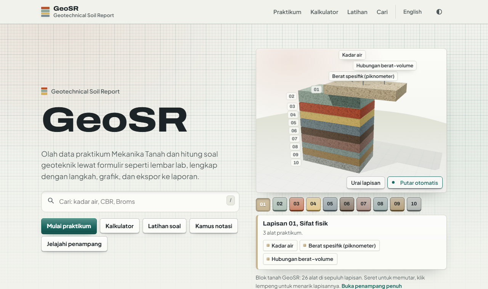

# GeoSR · Geotechnical Soil Report

[Bahasa Indonesia](README.md) · **English**

Tools for Soil Mechanics lab data, geotechnical calculators, and practice problems that show every calculation step and the source of each formula, published at **[defsayurinda.github.io](https://defsayurinda.github.io/en/)**. Made by Defsa Yurinda ([about](https://defsayurinda.github.io/en/pembuat/)), Civil Engineering, Universitas Jambi.

The tools are written in Indonesian and follow the Soil Mechanics lab forms at Universitas Jambi. Numbers use a decimal comma.

<picture>
  <source media="(prefers-color-scheme: dark)" srcset="docs/assets/tangkapan-beranda-gelap.png">
  
</picture>

## What is inside

- **18 lab data tools** (`docs/praktikum/`): water content, specific gravity, Atterberg limits, sieve and hydrometer analysis, compaction, sand cone, CBR, permeability, direct shear, unconfined compression, consolidation, CPT, and SPT. Each tool has a form like the lab sheet, a worked calculation, charts, and export to Word and Excel.
- **6 calculators** (`docs/kalkulator/`): axial and lateral (Broms) capacity of piles, bearing capacity of shallow foundations, consolidation settlement, and soil parameter correlations from SPT and CPT.
- **Practice problems** (`docs/latihan/`): problems generated with random numbers, checked automatically, with worked solutions.

## How it is checked

- Every formula names its source (SNI, ASTM, or a standard textbook) on the tool page; values that are not yet verified are marked.
- `python skrip/bangun_situs.py --periksa` checks that the site matches `konten/`, and the `tests/verifikasi_*.py` scripts compare the tools with textbook examples and sample lab reports. Both run in CI on every pull request.

## License

Code: [MIT](LICENSE). Writing and images: [CC BY 4.0](LICENSE-TULISAN). Fonts and KaTeX: see [asset credits](https://defsayurinda.github.io/kredit/).
