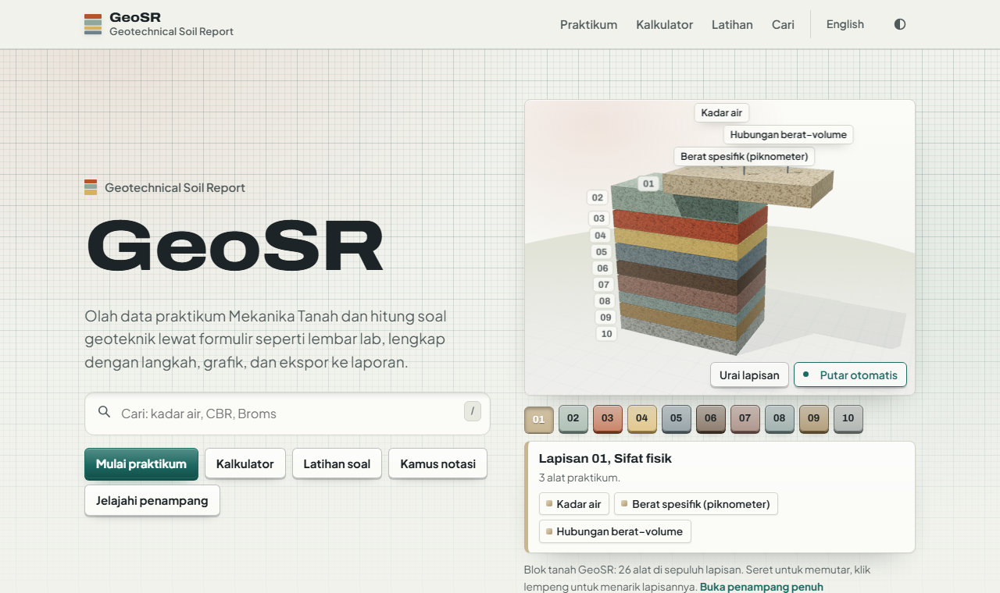

# GeoSR · Geotechnical Soil Report

**Bahasa Indonesia** · [English](README.en.md)

Pengolah data praktikum Mekanika Tanah, kalkulator geoteknik, dan latihan soal yang menampilkan langkah hitungan dan sumber rumusnya, terbit di **[geosr-lab.github.io](https://geosr-lab.github.io/)**. Dibuat oleh Defsa Yurinda ([profil](https://geosr-lab.github.io/pembuat/)), Teknik Sipil Universitas Jambi.

[](https://github.com/geosr-lab/geosr-lab.github.io/actions/workflows/verifikasi.yml)
[](LICENSE)
[](LICENSE-TULISAN)

<picture>
  <source media="(prefers-color-scheme: dark)" srcset="docs/assets/tangkapan-beranda-gelap.png">
  
</picture>

## Alat

Kolom status menunjukkan sumber rumus: asli (dicocokkan dengan sumber aslinya dan diuji dengan contoh soal buku), sekunder (dari sumber yang mengutip sumber asli), atau belum terverifikasi.

<!-- ALAT:MULAI -->
| Alat | Isi | Status sumber |
|---|---|---|
| [Kalkulator Tiang Bor N-SPT](https://geosr-lab.github.io/kalkulator/tiang-bor.html) | Hitung daya dukung aksial tiang bor dari data N-SPT dengan metode Reese & Wright (1977), lengkap dengan langkah hitungan dan asumsinya. | Sumber sekunder |
| [Kalkulator Lateral Tiang Broms](https://geosr-lab.github.io/kalkulator/broms-lateral.html) | Hitung beban lateral ultimit tiang tunggal metode Broms di tanah kohesif atau nonkohesif, kepala bebas atau terjepit, dengan moda keruntuhan, panjang peralihan, dan langkah hitungan. | Sumber sekunder |
| [Kalkulator Pondasi Dangkal](https://geosr-lab.github.io/kalkulator/pondasi-dangkal.html) | Hitung kapasitas dukung pondasi dangkal dengan persamaan daya dukung umum: faktor bentuk, kedalaman, dan koreksi muka air tanah, lengkap dengan langkah hitungan. | Belum terverifikasi |
| [Kalkulator Penurunan Konsolidasi](https://geosr-lab.github.io/kalkulator/konsolidasi.html) | Hitung penurunan konsolidasi primer satu dimensi untuk lempung NC dan OC beserta lajunya terhadap waktu, lengkap dengan diagram e–log σ' dan langkah hitungan. | Belum terverifikasi |
| [Praktikum Mekanika Tanah](https://geosr-lab.github.io/praktikum/) | 18 alat pengolah data praktikum Mekanika Tanah: formulir seperti lembar data laboratorium, langkah hitungan, grafik, dan ekspor ke Word dan Excel. | Belum terverifikasi |
| [Latihan Soal Geoteknik](https://geosr-lab.github.io/latihan/) | Latihan soal geoteknik dengan angka acak dan pembahasan langkah demi langkah: sifat fisik tanah, batas Atterberg, pondasi dangkal, konsolidasi, tiang bor, tiang lateral, dan penyelidikan tanah. | Belum terverifikasi |
| [Kalkulator Korelasi N-SPT](https://geosr-lab.github.io/kalkulator/korelasi-spt.html) | Koreksi N-SPT ke N60 dan (N1)60, lalu perkiraan kepadatan relatif, sudut geser, modulus elastisitas pasir, kuat geser undrained lempung, dan kecepatan gelombang geser, dengan rujukan halaman. | Sumber sekunder |
| [Kalkulator Korelasi Sondir](https://geosr-lab.github.io/kalkulator/korelasi-cpt.html) | Dari qc dan fs sondir, perkiraan kepadatan relatif dan sudut geser pasir, serta kuat geser undrained, sensitivitas, OCR, rasio kompresi, dan kecepatan gelombang geser lempung, dengan rujukan halaman. | Sumber sekunder |
| [GeoFEM 3D](https://geosr-lab.github.io/geofem3d/) | Analisis elemen hingga 3D untuk pondasi telapak di tanah berlapis, langsung di browser: penurunan, tegangan, titik plastis, dan angka keamanan reduksi φ-c. | Belum terverifikasi |
<!-- ALAT:SELESAI -->

## Cara memakai

1. Buka alatnya di situs. Data contoh sudah terisi, jadi hasilnya langsung terlihat.
2. Ganti data dengan soal atau data praktikummu. Hasil dihitung ulang setiap angka berubah.
3. Baca bagian **Penyelesaian** untuk rumus, sumber, dan substitusinya, lalu **Catatan** untuk asumsinya.
4. Pakai **Salin tautan hasil** untuk berbagi data yang sama, atau **Cetak / simpan PDF**.

Semua alat berjalan di browser; data tidak dikirim ke server mana pun.

## Mengembangkan

```
pip install -r skrip/kebutuhan.txt
python3 skrip/bangun_situs.py
for f in tests/verifikasi_*.py; do python3 "$f"; done
```

| Folder | Isi |
|---|---|
| `konten/` | Tulisan sumber, registri alat (`alat.json`), daftar alat praktikum (`praktikum.json`), alamat situs (`situs.json`) |
| `docs/` | Situs yang diterbitkan GitHub Pages |
| `skrip/` | `bangun_situs.py` membangun halaman dari `konten/`; `buat.py` membuat kerangka alat atau catatan baru |
| `tests/` | Verifikasi hitungan, bank soal, tautan, tata letak, keamanan, dan registri |

Cara menambah catatan, soal, dan alat ada di [PANDUAN.md](PANDUAN.md); aturan tampilan di [DESIGN.md](DESIGN.md).

## Cara mengutip

Tombol **Cite this repository** di halaman repo membaca [CITATION.cff](CITATION.cff). Contoh APA:

> Yurinda, D. (2026). *GeoSR (Geotechnical Soil Report)* [Situs web]. https://geosr-lab.github.io/

Untuk tugas atau laporan, kutip juga sumber rumus aslinya yang tercantum di setiap alat.

## Kontribusi dan lisensi

Laporan salah hitung dan usul alat sangat membantu; pakai templat Issue yang tersedia. Lihat [CONTRIBUTING.md](.github/CONTRIBUTING.md), [Kode Etik](.github/CODE_OF_CONDUCT.md), dan [SECURITY.md](.github/SECURITY.md) untuk celah keamanan.

Kode berlisensi [MIT](LICENSE); tulisan dan gambar [CC BY 4.0](LICENSE-TULISAN). Keduanya boleh dipakai, disalin, dan diubah asal mencantumkan nama Defsa Yurinda dan tautan ke repo ini.
